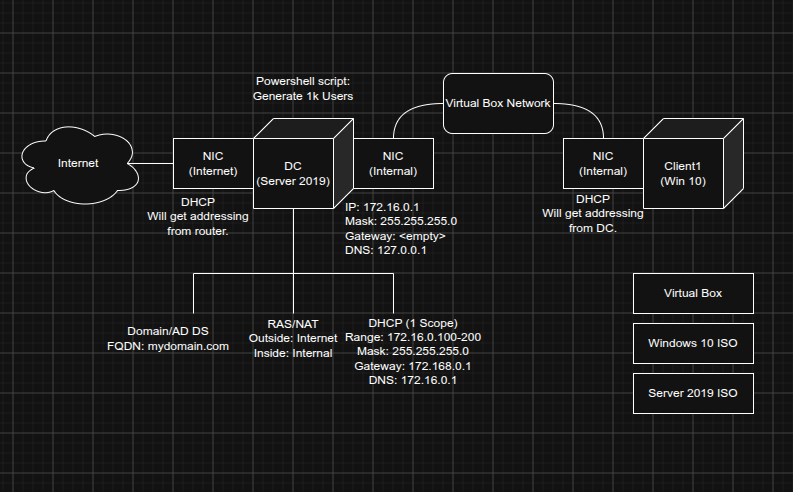

# Active Directory Infrastructure Lab | Windows Server 2019

I built a Windows domain lab in **Oracle VirtualBox** using **Windows Server 2019** and a **Windows 10** client. The server runs Active Directory Domain Services (AD DS), DNS and DHCP, with RRAS/NAT set up between its internal and external network interfaces. I also used PowerShell to create approximately 1,000 test accounts.

The aim was to get practical experience with Windows Server administration and see how directory services, IP addressing and client connectivity depend on one another. This is a guided home lab; I've credited the source material in [References and acknowledgements](#references-and-acknowledgements).

## Lab architecture

*My network diagram of the VirtualBox lab.*

The domain controller has two network adapters: one for outside connectivity and another for the isolated VirtualBox network. The Windows 10 client sits on that internal network and receives its IP settings from the server. The same server hosts the directory and DNS services that support the `mydomain.com` domain.

## Project objectives

- Set up a Windows Server domain controller and a Windows 10 domain client.
- Configure the internal network, DNS and a DHCP scope for the client.
- Set up RRAS/NAT between the server's internal and Internet-facing interfaces.
- Use PowerShell to populate Active Directory with test user accounts.
- Check the resulting configuration using Windows administration tools and command-line output.

## Environment

| Component | Configuration |
| --- | --- |
| Virtualisation | Oracle VirtualBox |
| Server | Windows Server 2019 (domain controller) |
| Client | Windows 10 (`CLIENT1`) |
| Domain | `mydomain.com` |
| Internal subnet | `172.16.0.0/24` |
| DC internal IP | `172.16.0.1` (static) |
| DC internal DNS setting | `127.0.0.1` (local DNS service) |
| DHCP address pool | `172.16.0.100`–`172.16.0.200` |
| DHCP gateway and DNS options | `172.16.0.1` |
| User provisioning | PowerShell script used for approximately 1,000 test accounts |

## Implementation

| Stage | What I configured | Technical notes |
| --- | --- | --- |
| **1. Virtual networking** | Two NICs on the domain controller and an internal network connection for `CLIENT1`; static internal server address | [Network configuration](docs/network-configuration.md) |
| **2. Active Directory and DNS** | AD DS and DNS on Windows Server 2019 for `mydomain.com` | [Active Directory and DNS](docs/active-directory-setup.md) |
| **3. DHCP and RRAS/NAT** | An IPv4 address pool for the client and NAT interfaces for internal/external traffic | [DHCP and RRAS/NAT](docs/dhcp-and-nat.md) |
| **4. User provisioning** | Bulk creation of test accounts with the tutorial's PowerShell script | [PowerShell user provisioning](docs/powershell-user-provisioning.md) |
| **5. Validation** | Checked the server settings, AD accounts, DHCP scope and client configuration | [Testing and results](docs/testing-and-results.md) |

## Results and evidence

These observations come from screenshots of my running virtual machines—not just the intended design.

| Area | Recorded result | Evidence |
| --- | --- | --- |
| Server networking | Internal NIC set to `172.16.0.1/24`, no gateway, DNS `127.0.0.1` | [IPv4 settings](images/01-internal-ip-config.png) |
| Active Directory | `mydomain.com` contains test users in `_USERS` | [AD Users and Computers](images/02-active-directory-users.png) |
| DHCP configuration | Scope covers `172.16.0.100`–`172.16.0.200` | [DHCP address pool](images/03-dhcp-scope.png) |
| RRAS/NAT | `Internet` and `Internal` interfaces appear in the NAT console | [RRAS console](images/04-rras-nat.png) |
| PowerShell / AD | `Get-ADUser -Filter * \| Measure-Object` returned **1,004 user objects** | [PowerShell output](images/05-user-provisioning.png) |
| Windows 10 client | `CLIENT1` received `172.16.0.100/24`, with gateway, DHCP and DNS server `172.16.0.1` | [Client `ipconfig /all`](images/06-client-validation.png) |

The PowerShell count includes other directory accounts; it is **not** a claim that the script created exactly 1,004 users. The client screenshot also shows a `mydomain` account context. I have not separately recorded proof of a fresh online domain sign-in, domain-controller discovery or successful outbound NAT traffic. The [testing page](docs/testing-and-results.md) separates confirmed observations from checks that were not captured.

## Practical skills covered

Working through this lab gave me hands-on exposure to Windows Server roles and administration tools, Active Directory user objects, PowerShell-assisted provisioning, virtual networking and Windows client configuration. In particular, it connected several topics that are often taught separately: a client needs suitable IP settings and DNS to find and use domain services, while a default gateway handles traffic beyond its local subnet.

The architecture diagram and supporting documentation record what was configured and what the available screenshots actually show.

## References and acknowledgements

This environment closely follows **Josh Madakor's guided Active Directory lab**. I carried out the setup, drew the architecture diagram and captured my own evidence. The bulk-user script is Josh Madakor's work, not code I independently wrote.

- [Josh Madakor — *How to Setup a Basic Home Lab Running Active Directory (Oracle VirtualBox) | Add Users w/PowerShell*](https://www.youtube.com/watch?v=MHsI8hJmggI)
- [Original PowerShell script repository — Josh Madakor / AD_PS](https://github.com/joshmadakor1/AD_PS)
- [Microsoft Learn — Active Directory Domain Services overview](https://learn.microsoft.com/en-us/windows-server/identity/ad-ds/get-started/virtual-dc/active-directory-domain-services-overview)
- [Microsoft Learn — DNS and Active Directory Domain Services](https://learn.microsoft.com/en-us/windows-server/identity/ad-ds/plan/dns-and-ad-ds)
