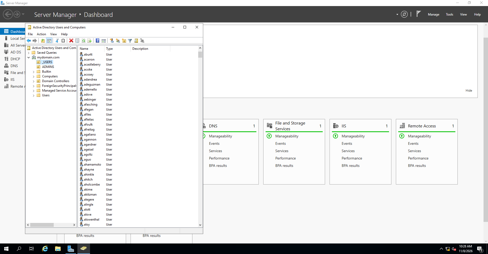

# Active Directory Domain Services and DNS

[← Back to project overview](../README.md)

I configured **Windows Server 2019** as a domain controller for the lab domain `mydomain.com`. Active Directory Domain Services (AD DS) provides a central place for the domain's user and computer objects; DNS helps clients find the domain controller and its services.

## Domain setup

The server runs AD DS and the DNS Server role. Rather than managing every user as a separate local Windows account, the domain lets accounts be maintained centrally and used by domain-connected computers.

This is a private training domain name within the lab. It does not imply ownership of the public `mydomain.com` Internet domain.

## How DNS fits into the lab

Active Directory depends on DNS, including **SRV (service-location) records**, to help a client find the domain controller. That is why the DNS settings matter as much as the network connection itself.

- On the DC's internal adapter, **`127.0.0.1`** directs DNS queries to the server's own DNS service.
- On the Windows 10 client, DHCP supplies **`172.16.0.1`** so DNS queries reach that service over the internal network.

A client could have a working IPv4 address but still struggle to locate the domain if its DNS server were pointing somewhere unrelated.

## Organisational units and users

The Active Directory Users and Computers console shows the **`_USERS`** and **`ADMINS`** organisational units under `mydomain.com`. The `_USERS` OU contains a large number of test accounts created using the guided PowerShell provisioning process.

*Active Directory Users and Computers showing the domain structure and generated users.*

A separate PowerShell query returned **1,004 directory user objects**. That count includes other accounts and should not be read as the exact number produced by the script. The script and its source are covered in [PowerShell user provisioning](powershell-user-provisioning.md).

## Windows 10 domain client

`CLIENT1` is the Windows 10 VM connected to the private lab network. Its captured Command Prompt output shows the `mydomain\sbeater` account context and the expected DHCP-assigned network settings. The `whoami` output identifies the account in use.

The distinction between what is visible and what was not separately tested is recorded in [Testing and results](testing-and-results.md).
