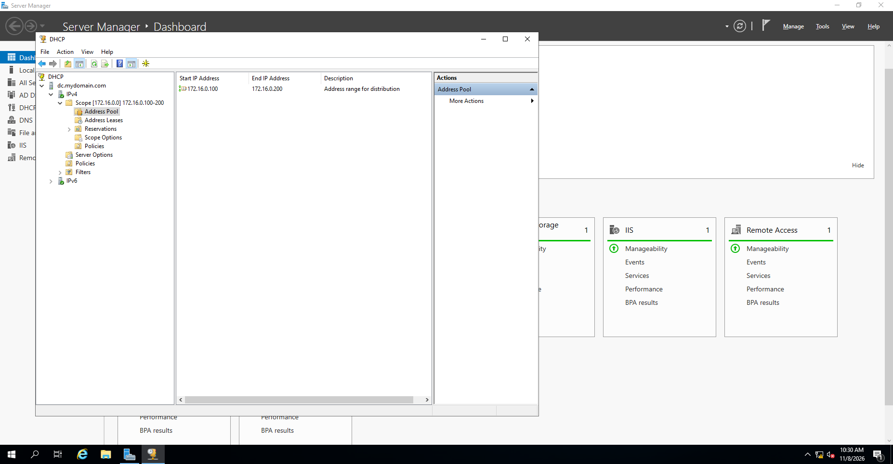
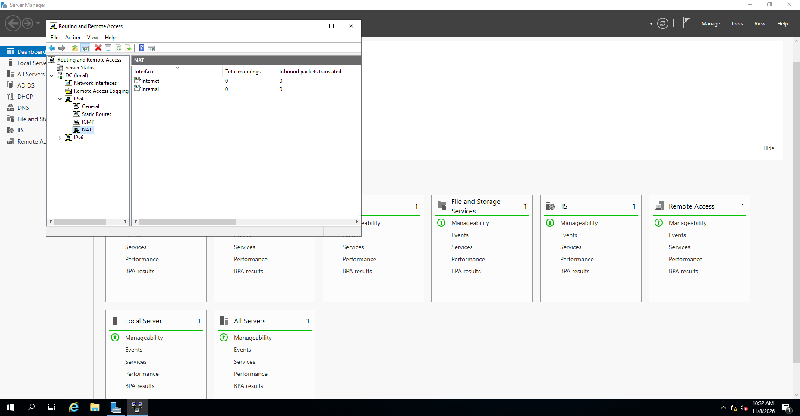

# DHCP and RRAS/NAT

[← Back to project overview](../README.md)

I configured **DHCP** on Windows Server 2019 to provide network settings to the Windows 10 client. I also set up **Routing and Remote Access (RRAS)** with NAT interfaces for the internal and Internet-facing sides of the lab.

## DHCP address pool

| Setting | Configuration |
| --- | --- |
| Address range | `172.16.0.100`–`172.16.0.200` |
| Subnet mask | `255.255.255.0` (`/24`) |
| Router / default gateway option | `172.16.0.1` |
| DNS server option | `172.16.0.1` |



*The DHCP address pool configured on the domain controller.*

The server itself uses the static internal IP **`172.16.0.1`**, outside the pool. This leaves DHCP to allocate client addresses dynamically without assigning the server's address to another device.

When `CLIENT1` requests a lease on the internal network, DHCP supplies an address plus the gateway and DNS details. In the final Windows 10 capture, `ipconfig /all` shows **`172.16.0.100/24`**, with `172.16.0.1` listed as the DHCP server, gateway and DNS server. That is direct evidence of a successful DHCP lease; the screenshot is in [Testing and results](testing-and-results.md).

## RRAS and NAT

The domain controller has an internal NIC for `172.16.0.0/24` and a separate Internet-facing NIC. RRAS/NAT is configured to handle traffic between the two sides of the lab.

```text
CLIENT1 (172.16.0.100)
    → Internal VirtualBox network
    → DC internal NIC (172.16.0.1)
    → RRAS / NAT
    → Internet-facing NIC
```

**Routing** chooses how traffic moves between networks. **Network Address Translation (NAT)** translates internal source addresses when traffic passes out through the external interface. DHCP is separate: it supplies addresses and other settings but does not forward traffic itself.



*Routing and Remote Access console showing the `Internet` and `Internal` NAT interfaces.*

The screenshot confirms that both interfaces are listed in the NAT console. It does **not** show a successful outbound connection or translated traffic, so external connectivity is not presented as a verified result.

This combination of services is useful for a contained home lab. It isn't intended as a production design recommendation: organisations commonly separate routing and security functions from a domain controller.
