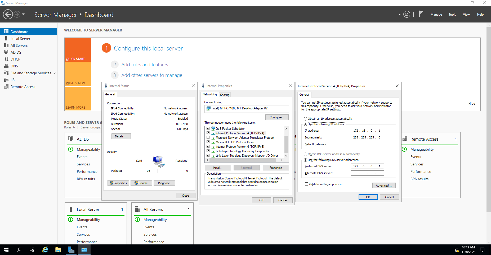

# Virtual networking and IP configuration

[← Back to project overview](../README.md)

The lab uses a separate internal VirtualBox network so the Windows 10 client can access the domain controller's services without being placed directly on my normal home network. The Windows Server VM also has an Internet-facing adapter for the routing/NAT part of the exercise.

## Network adapters

| Machine | Connection | Role |
| --- | --- | --- |
| Windows Server 2019 (`DC`) | Internet-facing adapter | External network path |
| Windows Server 2019 (`DC`) | VirtualBox Internal Network adapter | Connection to the private lab subnet |
| Windows 10 (`CLIENT1`) | VirtualBox Internal Network adapter | Connects to the DC for DHCP, DNS and domain services |

Both internal adapters need to use the same VirtualBox internal-network name. The diagram shows this network conceptually; the exact VirtualBox adapter settings and external IP address have not been captured. The original tutorial uses VirtualBox NAT for the external connection, where addressing is normally supplied by VirtualBox rather than directly by the physical router.

## Domain controller: internal NIC

I configured the server's internal adapter with the following static settings:

| Setting | Value |
| --- | --- |
| IPv4 address | `172.16.0.1` |
| Subnet mask | `255.255.255.0` (`/24`) |
| Default gateway | Blank |
| Preferred DNS server | `127.0.0.1` |

*Internal adapter properties on Windows Server 2019.*

The static address gives the Windows 10 client a consistent destination for the server's DHCP, DNS and domain services. The internal adapter has no default gateway; the separate external adapter provides the server's outside network path.

The `127.0.0.1` DNS setting points the server back to its **own** DNS service. Clients cannot use that loopback address to reach the server, so the DHCP configuration instead supplies **`172.16.0.1`** as their DNS server.

## What the client needs

The client is configured for automatic IPv4 addressing. The DHCP scope provides an address from `172.16.0.100`–`172.16.0.200`, with a `/24` subnet mask and these two important options:

- **DNS server `172.16.0.1`** — lets the client query DNS on the domain controller, including records used by Active Directory.
- **Default gateway `172.16.0.1`** — directs traffic for destinations outside the internal subnet to the server's routing/NAT service.

Those options point to the same IP address but serve different purposes. Having an IP address alone is not enough for a Windows domain client: DNS must also be configured correctly for it to locate domain services.

The Windows 10 screenshot confirms that the client later obtained the expected address and options. See [Testing and results](testing-and-results.md) for the recorded `ipconfig /all` output and the brief DHCP-renewal issue encountered while capturing evidence.
