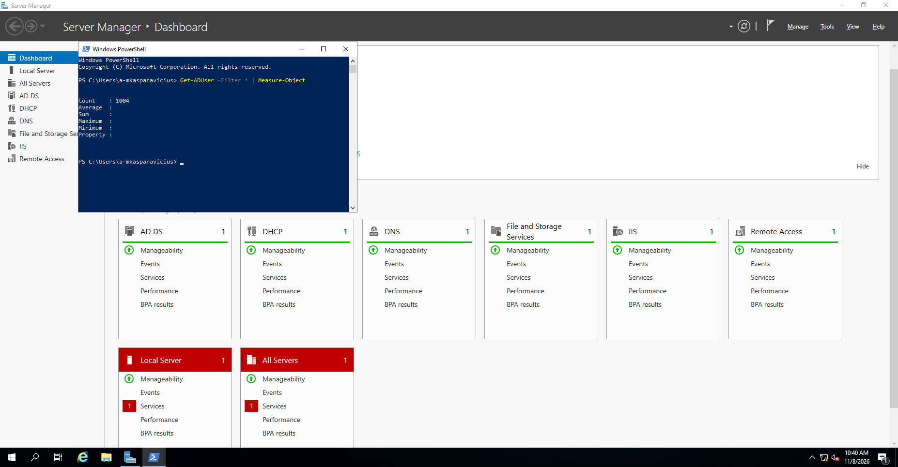

# PowerShell-assisted user provisioning

[← Back to project overview](../README.md)

Creating hundreds of accounts one at a time in Active Directory Users and Computers would be repetitive. For this lab, I ran the **PowerShell user-creation script from Josh Madakor's tutorial** to populate the domain with approximately **1,000 test accounts**.

## Bulk account creation

The script creates Active Directory user objects in bulk rather than requiring each one to be entered through the GUI. The underlying PowerShell command used for creating AD accounts is `New-ADUser`. This was a practical way to work with a populated directory and see how scripting can support routine administration.

The `_USERS` organisational unit is populated with test accounts in the [Active Directory console screenshot](../images/02-active-directory-users.png).

## Checking the directory

After the lab was built, I ran the following command on the domain controller:

```powershell
Get-ADUser -Filter * | Measure-Object
```



*PowerShell returned `Count: 1004` for the directory-wide user query.*

The result counts **all AD user objects returned by the query**, not just those created by the script. It is consistent with a directory populated by approximately 1,000 test users, but it is not an exact script-execution count.

## Security and source credit

The script is intended for an isolated lab. Test passwords or simplified account settings used in training should not be carried into a production environment, and credentials should never be committed to a public GitHub repository.

**Source and author:** [Josh Madakor — AD_PS repository](https://github.com/joshmadakor1/AD_PS), used alongside his [Active Directory home lab tutorial](https://www.youtube.com/watch?v=MHsI8hJmggI). The script is credited to its original author; my contribution here was using it in the completed lab and verifying the resulting directory objects.
