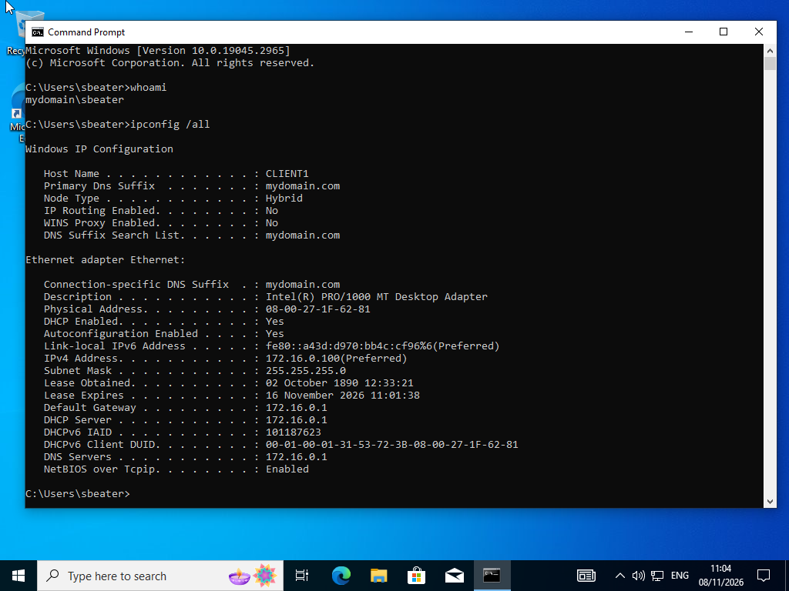

# Testing and results

[← Back to project overview](../README.md)

This page brings together the evidence captured from the Windows Server 2019 and Windows 10 VMs.

## Recorded evidence

| Area | Observed result | Screenshot |
| --- | --- | --- |
| DC internal NIC | Static IP `172.16.0.1/24`; gateway blank; DNS `127.0.0.1` | [IPv4 properties](../images/01-internal-ip-config.png) |
| Active Directory | `mydomain.com` with test users in `_USERS` and an `ADMINS` OU | [AD Users and Computers](../images/02-active-directory-users.png) |
| DHCP scope | Address pool `172.16.0.100`–`172.16.0.200` | [DHCP Manager](../images/03-dhcp-scope.png) |
| RRAS/NAT | `Internet` and `Internal` interfaces listed | [RRAS console](../images/04-rras-nat.png) |
| AD user count | `Get-ADUser -Filter * \| Measure-Object` returned **1,004** objects | [PowerShell output](../images/05-user-provisioning.png) |
| Windows 10 networking | Client IP `172.16.0.100/24`; DHCP server, gateway and DNS `172.16.0.1` | [Client output](../images/06-client-validation.png) |
| Windows 10 user context | `whoami` returned `mydomain\sbeater` | [Client output](../images/06-client-validation.png) |

## Windows 10 DHCP verification

On `CLIENT1`, I used these commands to check the network configuration and current user:

```cmd
ipconfig /all
whoami
```



*`CLIENT1` received `172.16.0.100/24`, with DHCP, DNS and gateway set to `172.16.0.1`. The account context was `mydomain\sbeater`.*

The `172.16.0.100` address falls within the scope configured on the server. Along with the displayed DHCP server and network options, this confirms the client successfully received its expected IPv4 configuration at the time of capture.

### A DHCP issue during evidence capture

In my first screenshot, Windows 10 had assigned itself a `169.254.x.x` address instead of receiving one from DHCP. This is an **APIPA** address, which Windows can use when it cannot obtain a DHCP lease. The domain controller may not have been running at that point, although I did not confirm the cause.

After the server was available, I renewed the client's DHCP lease with `ipconfig /renew`. The later screenshot shows the expected **`172.16.0.100`** address and network settings. This was a real issue encountered while collecting project evidence, not a simulated troubleshooting scenario.

## Active Directory verification

On Windows Server 2019, I ran:

```powershell
Get-ADUser -Filter * | Measure-Object
```

The output returned **1,004 user objects**. The AD Users and Computers screenshot independently shows the populated `_USERS` OU. Because the command counts other existing directory accounts as well.
